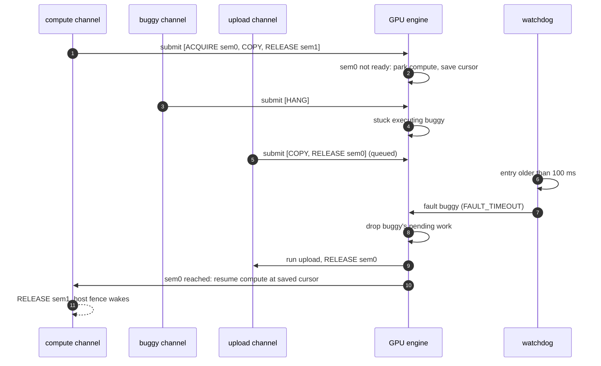

# gpu-channel-sim

[](https://github.com/ribhu0908/gpu-channel-sim/actions/workflows/ci.yml)

A C11 + pthreads model of how a GPU consumes work from many clients at once: **GPFIFO channels, pushbuffer methods, semaphore fences, round-robin channel scheduling, and watchdog-driven channel recovery**. Built to reason about, and test, the firmware/driver logic that sits between "the host submitted work" and "the engine finished it", the part where hangs, bad commands and cross-channel deadlocks have to be survived.

> This is a host-side simulator for learning and testing scheduling and recovery logic. It does not talk to real GPU hardware. The concepts follow the publicly documented NVIDIA / nouveau channel model (GPFIFO, GP_GET/GP_PUT, semaphore acquire/release).

## Live demo

**[GPU Channel Lab](https://ribhu0908.github.io/gpu-channel-sim/)** is an interactive 3D model of this simulator: four channels feed one engine, with a guided tour, the real C functions lighting up as events happen, a memory-ordering lesson, and the benchmark below. Open `docs/index.html` locally or serve it with GitHub Pages (Settings, Pages, deploy from branch, folder `/docs`).

The page is a JavaScript re-implementation of the scheduler logic for visualisation. It does not run the C code.

### Benchmark

`bench/bench.c` measures host-side `gpu_submit` cost and end-to-end throughput against any revision. On a shared 4-vCPU container (7 runs, 100,000 NOP entries per thread, medians of two rounds):

| Case | device mutex | atomic ring |
|---|---|---|
| 1 thread, 1 channel | 728 ns/submit | 939 ns/submit |
| 4 threads, one channel each | 3.98 us | 2.54 us |
| 4 threads, one shared channel | 4.25 us | 23.7 us |

The atomic ring is faster when threads use separate channels and slower on a shared one, because `gpu_submit` rings the doorbell while holding `submit_lock`. Ringing it after the unlock (not yet applied here) brought the shared case to about 3.9 us in a scratch experiment.

## Demo

```
$ make demo
[   0.2 ms] compute submitted (waits on sem0)
[   5.4 ms] buggy   submitted (will hang)
[  10.5 ms] upload  submitted (engine is stuck on buggy)
[ 126.4 ms] compute finished -> "frame #42 pixels"
[ 126.4 ms] buggy   channel status: FAULT_TIMEOUT
[ 126.6 ms] buggy   recovered and ran new work: OK

stats: entries=3 methods=6 ctx_switches=1 faults=1 watchdog_resets=1
```

What happened:
1. `compute` reached a `SEM_ACQUIRE` whose producer hadn't run yet, so the engine **parked it mid-segment and context-switched** instead of blocking.
2. `buggy` hung the engine. The **watchdog (100 ms) faulted that channel only**, dropped its pending work, and the engine moved on.
3. `upload` ran and released the semaphore; `compute` **resumed exactly where it stopped** and finished.
4. `buggy` was recovered and accepted new work.

## How it flows



## Model

```
 host threads                          engine thread                     watchdog thread
 ------------                          -------------                     ---------------
 pb_fill/pb_copy/...  builds methods
 gpu_submit()  --> GPFIFO[GP_PUT++] --> pick runnable channel (round robin)
               --> doorbell             run ONE entry (timeslice):         active entry older
                                          FILL / COPY  -> VRAM              than timeout?
 gpu_sem_wait() <-- SEM_RELEASE  <--      SEM_RELEASE  -> wake host fences  -> fault channel,
                                          SEM_ACQUIRE  unmet -> park,          abort entry
                                                       save cursor, switch
                                          bad method / bad address -> fault channel
```

Engine loop:


| Piece | Behaviour |
|---|---|
| **Pushbuffer** | 32-bit method stream: header `[31:24] opcode, [23:0] arg count` + args. Builders refuse to overflow a segment. |
| **GPFIFO** | Per-channel lock-free SPSC ring of 16 segments with `_Atomic` `GP_PUT` / `GP_GET` (acquire/release, see design notes). `gpu_submit` returns `-EAGAIN` when full (back-pressure), `-EIO` once faulted. Many host threads may share a channel; a per-channel submit lock makes them one producer. |
| **Semaphores** | 64 x 32-bit, compared wrap-safe (`(int32_t)(cur - want) >= 0`). Used for host fences and channel-to-channel dependencies. |
| **Scheduling** | One entry per timeslice, round-robin. An unmet `ACQUIRE` parks the channel with its cursor saved; it becomes runnable only when the semaphore is reached. |
| **Fault isolation** | Unknown opcode, wrong arg count, truncated method, out-of-range VRAM or semaphore id each fault *only* the offending channel. |
| **Watchdog** | Checks every `timeout/4`; if one entry has held the engine longer than `timeout`, it faults that channel and kicks the engine. Detection latency is therefore `timeout` to `1.25 x timeout`. |
| **Acquire timeout** | `gpu_set_acquire_timeout(dev, ms)`: a channel parked on an unmet `ACQUIRE` for longer than `ms` is faulted with `FAULT_ACQUIRE_TIMEOUT`, so a consumer whose producer died does not wait forever. Off by default; a waiter whose semaphore is met in time is never faulted. |
| **Recovery** | `gpu_channel_recover()` clears the fault and empties the ring so the channel can be reused, refusing with `-EBUSY` while it is still on the engine. |

## Build & test

```sh
make test         # gcc, -Wall -Wextra -Werror -Wconversion
make test CC=clang
make asan         # AddressSanitizer + UBSan
make tsan         # ThreadSanitizer: engine, watchdog and host threads race-free
make portable     # macOS timing path (realtime-clock condvars), runnable on Linux
make demo
```

Runs on Linux and macOS with no GPU required. CI builds on both `ubuntu-latest` and `macos-latest`.

93 checks across 11 tests, all passing under gcc, clang, ASan/UBSan and TSan, including repeated TSan runs and 8 concurrent instances under CPU contention:

| Test | Proves |
|---|---|
| `fill_copy_and_fence` | Methods execute correctly; fence wakes the host |
| `cross_channel_dependency` | Consumer submitted *before* producer is parked, not run early, then resumed |
| `ping_pong` | 80 semaphore hand-offs between two channels inside single segments, no deadlock |
| `invalid_method_is_isolated` | Bad opcode, truncated args and out-of-range VRAM fault only their own channel; recovery works |
| `watchdog_recovers_hang` | Hang detected within the window, queued work dropped, healthy channel unaffected |
| `gpfifo_backpressure` | Ring-full returns `-EAGAIN`; clean shutdown while channels are stalled |
| `pushbuffer_builder_bounds` | Builders never write past a segment |
| `multithreaded_stress` | 4 host threads x 400 submissions with retries: every entry retires, zero faults |
| `shared_channel_many_producers` | 4 host threads x 300 submissions on *one* channel: no lost or torn entry, per-thread order kept |
| `acquire_timeout_dead_producer` | Producer faults before releasing; consumer is faulted within the window, healthy channel unaffected, consumer reusable |
| `acquire_timeout_spares_live_waiters` | Off by default (long wait survives); when on, a slow-but-alive producer's consumer is not killed |

## Design notes

- **Lock-free ring, explicit memory ordering.** Work moves through each GPFIFO without the device lock, as on hardware where the host only writes `GP_PUT`:
  - host writes the segment, then **release**-stores `GP_PUT` (the write barrier before the real `GP_PUT` / doorbell write);
  - engine **acquire**-loads `GP_PUT`, so the segment is fully visible before it reads it, then **release**-stores `GP_GET + 1` when done;
  - host **acquire**-loads `GP_GET` before reusing a slot, so it never overwrites a segment the engine is still reading.

  Indices are free-running `uint32_t`, so fullness is `put - get >= 16` and survives wraparound. The device mutex now guards only scheduler state, semaphores and stats; the doorbell takes it briefly so the engine's condvar sleep cannot miss a wakeup (a real engine is woken by a register write, not a condvar).
- **Faults vs. in-flight submits.** A host may publish an entry just after its channel faults. That entry is dead: the engine skips faulted channels, `idle_wait` treats a faulted channel as idle once it is off the engine, and `recover` (holding the submit lock, so `GP_PUT` is frozen) discards everything up to `GP_PUT`.
- **A fence fires mid-entry.** `SEM_RELEASE` is visible before the GPFIFO entry that contains it retires. Code that needs "entry fully retired" (e.g. reading stats) uses `gpu_channel_idle_wait()`. The stress test originally failed 2 runs in 20 by mixing these up, which is why it is documented here.
- **Hang vs. slow.** The watchdog cannot tell a stuck shader from a very long legitimate copy; both are faulted once they exceed the timeout. Real drivers face the same trade-off, which is why the timeout is configurable. The acquire timeout has the same trade-off for a slow producer, which is why it is opt-in.

## Limitations / next steps

- Single engine (no separate copy engine); no preemption inside a method.
- Simplified method header and GPFIFO entries. Real NVIDIA headers carry subchannel, method address, count and incrementing/non-incrementing mode, and a GPFIFO entry is a GPU virtual address + length pointing at a pushbuffer, not a copy of it.
- No runlists / TSGs or channel priorities; scheduling is plain round-robin.
- No virtual memory / page faults.

## License

MIT
